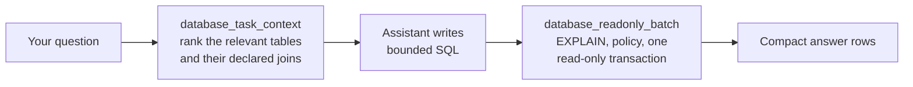
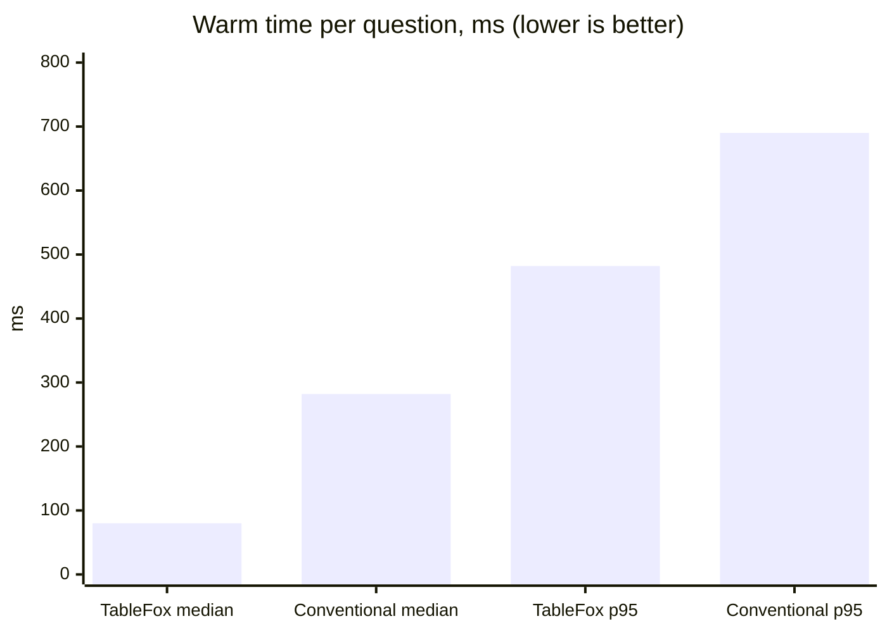
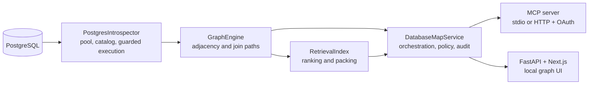

<p align="center">
  
</p>

<h1 align="center">TableFox</h1>

<p align="center">
  <strong>Ask your PostgreSQL database anything, from any AI assistant. Read-only.</strong>
</p>

<p align="center">
  TableFox finds the few tables a question needs and runs guarded, read-only queries for ChatGPT, Claude, Claude Code, Codex, Cursor and any other MCP client, instead of pasting your whole schema into every prompt.
</p>

<p align="center">
  <a href="https://tablefox.onrender.com"><strong>Website</strong></a> ·
  <a href="https://tablefox.onrender.com/docs"><strong>Get started</strong></a> ·
  <a href="https://tablefox.onrender.com/benchmark"><strong>Benchmark</strong></a> ·
  <a href="https://tablefox.onrender.com/security"><strong>Security</strong></a>
</p>

<p align="center">
  
  
  
  
</p>

---

## Why TableFox

An assistant pointed at a database doesn't know the schema. Pasting a schema dump into the prompt grows with the database, costs tokens on every turn, and still produces made-up table names. TableFox replaces the dump with two small calls:



Nothing about your rows is indexed or cached, and nothing can be written.

## Get started

**Hosted (quickest):** add this address to your assistant and sign in:

```
https://tablefox.onrender.com/mcp
```

Then ask a question. TableFox replies with a private link where you connect a read-only database user. Step-by-step guides for ChatGPT, Claude and every coding agent: **[tablefox.onrender.com/docs](https://tablefox.onrender.com/docs)**.

**Self-hosted:** run it on your own machine so your password never leaves it. This is also the way to reach databases on private networks.

```bash
git clone https://github.com/Adhrit-Verma/TableFox.git && cd TableFox
python -m venv .venv && .venv/bin/pip install -e services/dbmap
echo "DATABASE_URL=postgresql://reader:<password>@db.example.com:5432/postgres?sslmode=require" > .env
claude mcp add tablefox --env DBMAP_ENV_FILE=$PWD/.env -- $PWD/.venv/bin/dbmap-mcp   # or any MCP client
```

| Guide | For |
|---|---|
| [User guide](docs/USER_GUIDE.md) | Connecting from ChatGPT or Claude, read-only users, troubleshooting |
| [Agents and assistants](docs/AGENTS.md) | Claude Code, Codex, Cursor, VS Code, Gemini CLI, Windsurf: hosted and self-hosted |
| [Developer guide](docs/DEVELOPER_GUIDE.md) | Architecture, configuration, tests, hosting your own multi-user instance |
| [Agent guide](MCP_AGENT_GUIDE.md) | How an AI agent should use the tools |

## Benchmark

Measured on a deliberately messy **71-table, 25-million-row** PostgreSQL database (10 schemas, 748 columns, 147 foreign keys, 3.9 GB) with **70 questions** in 10 categories, each run 3 times. TableFox is compared with what a careful developer does without it: catalog searches, then hand-written SQL on a fresh connection.

| Measure | TableFox | Conventional |
|---|---:|---:|
| Median time per question (warm) | **80 ms** | 282 ms |
| 95th percentile | **482 ms** | 690 ms |
| Estimated tokens per question | **1,892** | 2,493 |
| Needed tables found in the top 6 | **93.0%** (vague questions: 88%) | n/a |
| Same, on 40 unseen vague questions written by a separate agent | 81.0% (was 70.7%) | n/a |
| Answers identical to direct SQL, row for row | **64 / 64** (6 of 70 stopped by policy) | baseline |
| Write attempts refused | **17 / 17** | n/a |
| Blind test: assistant answers correctly from TableFox alone, one try (before the retrieval update) | 13 / 28 | n/a |
| Cold start, new process to first answer | 2.5 s | n/a |



**Where it is strong:** simple lookups, synonyms, joins, audit and log tables, ambiguous names and wide tables (100% of needed tables found), and now vague business questions ("who owes us money?"): 88%, up from 31% after adding business vocabulary and intent-aware ranking.

**Where it is weak, measured:**
- 4–5-table joins (80%).
- Context packs that leave out date and amount columns, which causes most blind-test misses.
- A personal-data filter that goes by column name only.

Full write-up, raw data and reproduction commands: [docs/benchmarks/large-db/summary.md](docs/benchmarks/large-db/summary.md). An earlier benchmark on a 38-table remote database (14 tasks) measured 1,200 ms against 2,396 ms with 14/14 matching answers. Results come from one machine; yours will vary.

## Safety model

TableFox assumes the database is production. A request must pass every layer:

| Control | Behaviour |
|---|---|
| Database user | Hosted mode only accepts users that cannot write, change the schema or administer; it checks this before saving |
| Statement validation | `SELECT` / `WITH` only; writes, DDL, multi-statement SQL, row locks and privileged functions are rejected before connecting |
| Transaction | Read-only, with statement and lock timeouts |
| Plan check | `EXPLAIN` runs first; cost and estimated-row ceilings apply |
| Joins | Multi-table queries must be connected by declared foreign keys or catalog dependencies |
| Personal data | Result columns named like emails, phones, passwords or keys are hidden. **This is name-based**: aliases and expressions bypass it, and IBANs, national and tax IDs, card digits and salaries are not recognised yet. Keep such columns out of the read-only user's grants |
| Credentials (hosted) | Entered on a private page, encrypted at rest, never shown to the assistant or logged; SSL and public addresses only |
| Audit | Actor, action and a SQL **hash**; never SQL text or rows |

These layers are defence in depth. The strongest protection is a least-privilege role:

```sql
create role tablefox_reader login password '<long random password>';
alter role tablefox_reader set default_transaction_read_only = on;
grant connect on database your_database to tablefox_reader;
grant usage on schema public to tablefox_reader;
grant select on all tables in schema public to tablefox_reader;   -- or only the tables/columns it needs
alter default privileges for role table_owner in schema public grant select on tables to tablefox_reader;
```

How the hosted service protects credentials, and what is not done yet: [tablefox.onrender.com/security](https://tablefox.onrender.com/security).

---

## For developers

### Architecture



Application rules live in `DatabaseMapService` once; MCP and HTTP only translate transport. Hosted multi-user mode (`tenants.py`) adds per-user services, an encrypted connection store and address vetting. The Python package is named `dbmap`.

### What it maps

| Database object | Captured |
|---|---|
| Schemas | names, filtering, allow/deny policy |
| Tables, views, materialized views | comments, row estimates, optional usage counters |
| Columns | type, nullability, default, comment |
| Keys and constraints | primary, foreign, unique, check, exclusion |
| Indexes | columns, uniqueness, definition |
| Relationships | foreign keys plus `pg_depend` view dependencies |

### MCP tools

| Tool | Purpose |
|---|---|
| `database_task_context` | Ranked relations, useful columns and declared joins for one question, within a byte budget |
| `database_readonly_batch` | Up to five named guarded reads in one transaction, returned as compact columnar rows |
| `database_connections` | (Hosted) list connected databases and get a private manage link |
| `database_connectivity_check` | Confirm credentials and server identity |
| `database_search`, `database_explain_object`, `database_neighbors` | Explore objects when the context is ambiguous |
| `database_find_join_path`, `database_source_of_truth` | Prove join routes; rank authoritative sources |
| `database_explain_query`, `database_readonly_query` | Plan without executing; a single guarded read |
| `database_graph_snapshot`, `database_schema_changes`, `database_context_identity` | Inventory, baseline diff, schema fingerprint |
| `database_context_window` | Read or set the context window |

Every tool takes an optional `database` name in hosted mode. Workflow and patterns: [MCP_AGENT_GUIDE.md](MCP_AGENT_GUIDE.md).

### Context window

A fixed-length record of relations already sent in a session. When a later question needs one, TableFox returns its id instead of its columns. On the large benchmark a window of 16 cut context tokens by 10.5% with no loss of coverage. It ships **disabled**. If the assistant's conversation is compacted it may lose those columns, so any call can pass `refresh_context=true`, and the window clears when the schema changes.

### Approved context

Retrieval reads schema text only. Describe tables whose meaning lives in their data (`dbmap-context-scaffold` writes a `.tablefox-context.json` skeleton); descriptions, owners and source-of-truth assertions then feed ranking. Code links are ignored unless the database identity and schema fingerprint match.

### Local graph UI and HTTP API

`.\run.cmd -Install` then `.\run.cmd` (Windows) starts the FastAPI service and a Next.js graph explorer at `http://localhost:3000`. The API exposes `/graph`, `/graph/search`, `/graph/node/{id}`, `/query/explain`, `/query/readonly`, `/query/readonly-batch`, `/workflow/task-context`, `/workflow/join-path`, `/workflow/source-of-truth` and a live graph socket. Enable API keys with `dbmap-create-key` and `DBMAP_AUTH_REQUIRED=true` (roles: viewer, analyst, data_reader, admin). The API only binds to loopback.

### Tests and benchmarks

```bash
python -m pytest -q
python -m ruff check services scripts
python scripts/benchmark_corpus.py --repeat 3                      # small corpus
python scripts/bench/benchmark_large.py run --repeat 3            # large DB (see scripts/bench/README.md)
```

## Roadmap

- [ ] Return PostgreSQL error text from batch queries so assistants can self-correct
- [ ] Include date, amount and status columns and types in context packs
- [ ] Source-column personal-data detection (no alias bypass) and more identifier types
- [x] Business vocabulary and intent-aware ranking for vague questions (31% → 88%; unseen questions 71% → 81%)
- [ ] Better multi-hop retrieval
- [ ] Encryption-key rotation and per-user rate limits for the hosted service
- [ ] MySQL support
- [x] Hosted multi-user mode with OAuth
- [x] Large-database benchmark (71 tables, 25M rows)

## License

[MIT](LICENSE) © 2026 Adhrit Verma · Contact: works.omen@gmail.com

<p align="center"><strong>Give your assistant a map before it queries your database.</strong></p>
